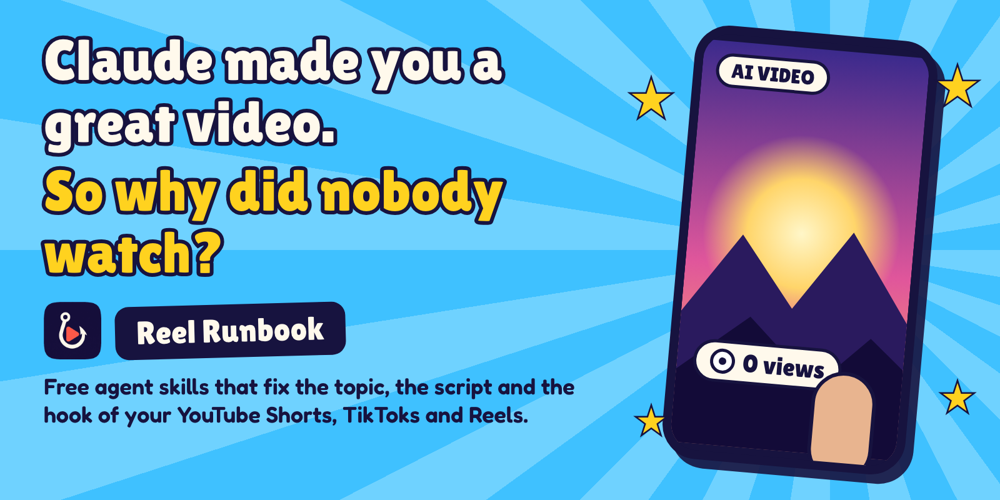
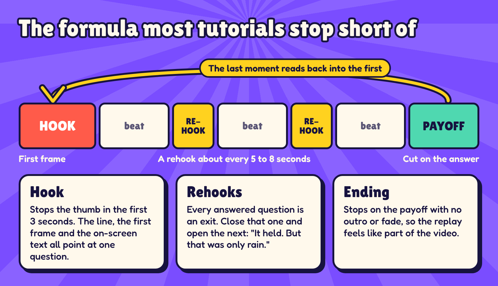
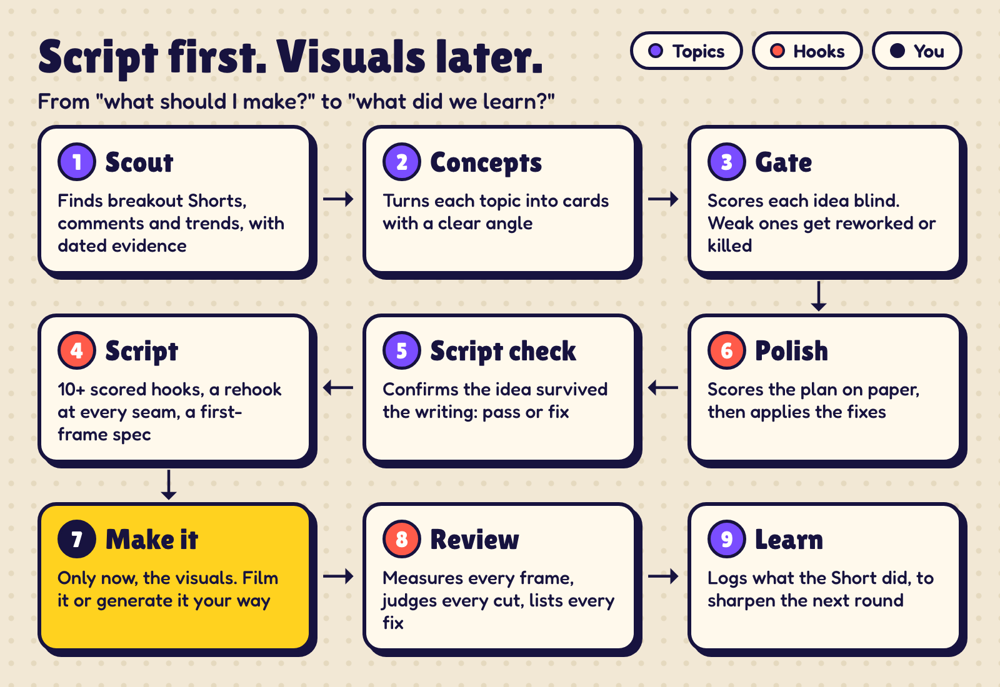
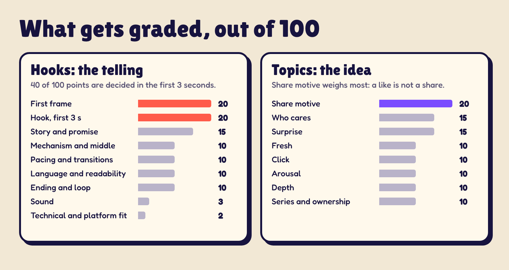
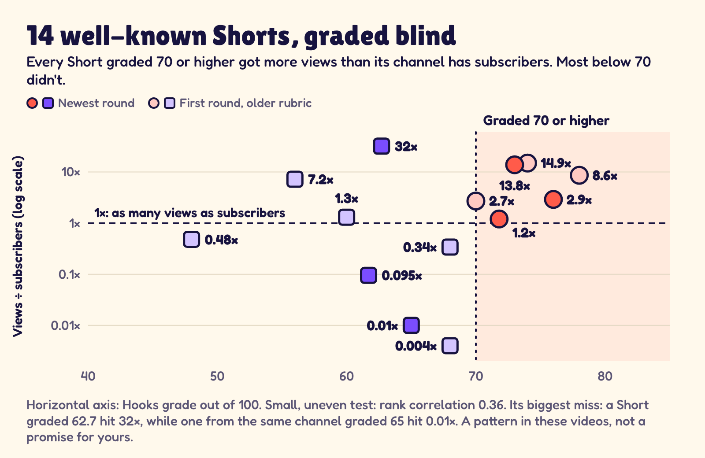
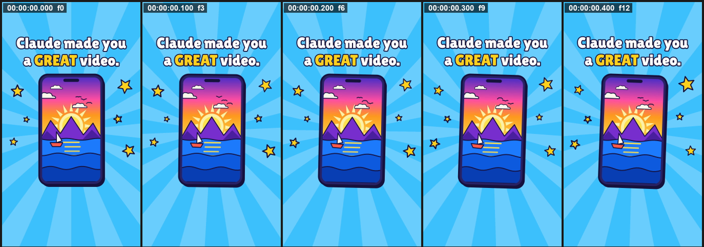

<p align="center">
  
</p>

<h1 align="center">Reel Runbook</h1>

<p align="center">
  <strong>Free Claude skills that write and review YouTube Shorts, TikToks and Instagram Reels people keep watching.</strong><br>
  Hooks, rehooks, loop endings, topic research and frame-by-frame video review, for any AI agent.
</p>

<p align="center">
  <a href="#install-in-30-seconds"></a>
  <a href="LICENSE"></a>
  
</p>

---

You had Claude make a video. The script reads fine. The visuals look great. Nobody watches.

**Without specific instructions, Claude just writes a normal script.** A good Short follows a repeatable formula that keeps people from swiping away. This repo teaches your agent that formula, then grades its work.

| Skill | What it does |
|---|---|
| **[Hooks](skills/hooks/SKILL.md)** (main) | Writes hook-first scripts and reviews finished videos frame by frame. Tells you exactly what to change, with timestamps. |
| **[Topics](skills/topics/SKILL.md)** (add-on) | Finds topics that aren't crowded and scores whether an idea is worth making before you make it. |

## Install in 30 seconds

```bash
claude plugin marketplace add opus-pro/reel-runbook
```

```bash
claude plugin install reel-runbook@reel-runbook
```

Then just ask:

```text
Make me a 30-second Short about why airplane windows are round. Hooks first.
```

```text
Review this Short frame by frame and be harsh: final_v3.mp4
```

```text
What should my channel post next? Find something that isn't crowded.
```

Using another agent? Each `SKILL.md` is plain markdown and the scripts are plain Python, so any agent that can run commands and look at images can follow them. Video review needs ffmpeg 6+ and Python 3.9+. See [full install and requirements](#full-install-and-requirements).

## Same story, better script

Same facts. One gets scrolled past, and one makes you wait for the ending.

| A normal script | With Hooks |
|---|---|
| A buyer texted a farmer a contract. | **One thumbs-up cost this farmer eighty-two grand.** ← *hook* |
| He replied with a thumbs-up. | The buyer texted "please confirm." The judge said: signature. |
| A court called it a signature. | **He appealed. And lost.** ← *rehook* |
| He had to pay eighty-two thousand dollars. | **How many did you send today?** ← *ending that reads back into the first line* |

*Written to show the difference. The story is a real 2023 Canadian court case.*

## The formula

Lots of tutorials teach the hook and stop there. But people also leave in the middle, and at the end.

<p align="center"></p>

Hooks gives your agent a bank of **14 hook families**, the tests to check a hook, and the rules for rehooks and loop endings. It also treats the first frame as a second hook, because the picture has to stop the thumb before anyone hears a word.

## Script first. Visuals later.

If the script sucks, everything else sucks. That's especially true for AI video, where great-looking visuals are now the easy part.

<p align="center"></p>

## It grades your work

Both skills score against a written rubric, with evidence for every point. Hooks grades the script and the finished video. Topics grades the idea, and in a full run a separate agent scores it blind, so the writer can't flatter their own concept.

<p align="center"></p>

Score too low? Back to the script.

## Does the grade mean anything?

We graded 14 well-known Shorts blind, then compared each grade with **views ÷ subscribers**, the multiplier that shows whether a Short reached past its own audience.

<p align="center"></p>

**Every Short graded 70 or higher got more views than its channel has subscribers. Most below 70 didn't.** The typical multiplier was 5.75× at 70 or higher, and 0.41× below it.

It's a small test, and the grade misses sometimes: one Short graded 62.7 reached 32×. So it's a pattern in these videos, not a promise for yours, and Hooks never predicts view counts. [See every number](docs/hooks-calibration.md).

## It was hard on our own launch video

These are real frames and real flags from running the analyzer on an early cut of our launch video.

<p align="center"></p>

```text
MAJOR  BLACK_MID           35.60s-35.77s   black 0.17s
MAJOR  TAIL_DEAD_TIME      52.15s-53.50s   last 1.35s silent
MINOR  DEAD_AIR            24.22s-24.77s   0.54s below -35 dB
MINOR  GRADUAL_TRANSITION  15.27s-16.43s   36 frames of soft change
INFO   LENGTH_OFF_TARGET                   53.5s vs 31-36s
```

Every finding cites a timestamp and frame or a measured value, and every problem comes with a concrete fix.

## What you can ask for

| You bring | You get |
|---|---|
| **A topic or rough script** | Story wrappers, 10+ scored hooks, a beat sheet built backwards from the payoff, a rehook at every seam, a readability-checked script, a first-frame spec and a shot plan |
| **A finished video** | A verdict and score, the top fixes ranked by impact, a log of every cut, a rehook map, rewritten hooks and an edit list with timestamps |
| **A posted Short and its analytics** | Each drop in the retention graph mapped to the frame that caused it, plus the fix |
| **A channel or niche** | A topic board with dated evidence: breakout Shorts, audience questions, trends and how crowded each topic is |
| **An idea** | An entertainment score with a verdict: Aha, Share and More, plus re-angles or a clear "don't make this" |

## FAQ

**Why do my YouTube Shorts get swiped away?**
Usually the first frame and the first three seconds give a stranger no reason to stay. YouTube Studio shows this as "viewed vs swiped away". Hooks maps that number and your retention graph to the exact frames that caused it.

**What is a rehook?**
A small hook placed where one beat ends and a viewer could feel done. It closes that question and opens the next one: "It held. But that was only rain." In a Short, you want one about every 5 to 8 seconds.

**How long should a YouTube Short be?**
There's no fixed answer. Creators often cite about 33 to 34 seconds, but that's one channel's observation, so Hooks treats it as something to test against your own analytics.

**Does this work with AI-generated video?**
Yes. It works on the script before you generate anything, and it reviews the finished file however it was made. It also has specific checks for AI hosts and hidden joins between generated clips.

**Does it work with Codex, Cursor or other agents?**
Yes, if the agent can read markdown, run commands and look at images. Copy `skills/hooks/` or `skills/topics/` into wherever your agent loads skills.

**Is it really free?**
Yes. It's MIT licensed. The skills themselves make no paid API calls, and optional transcription can run on your own machine.

**Will it make my video go viral?**
Nothing can promise that. It fixes what can be fixed in the script and the edit, and it never predicts views.

## Where the method comes from

The core comes from **Jenny Hoyos's** short-form practice, as relayed in a breakdown by the Taiwanese creator **Joeman**. The hook bank and rehooks also draw on a **Socialmon** guide to Reels hooks and **Marquise Peters'** video on rehooks. We then tested the grading blind against Shorts by creators including **MrBeast**, **Mark Tilbury**, **Zack D. Films**, **Nick DiGiovanni** and **Ryan Trahan**. Not the algorithm: the pattern.

Sources are paraphrased and credited in [`method.md`](skills/hooks/references/method.md), and every example line is the skill's own. Exact numbers such as "33 to 34 seconds" are one channel's observations, so they're treated as hypotheses. This project isn't affiliated with any creator or company named here, or with YouTube, Instagram, TikTok or Anthropic.

## Full install and requirements

<details>
<summary><strong>Install options</strong></summary>

**Claude Code plugin:** the two commands above give you `reel-runbook:hooks` and `reel-runbook:topics`.

**From a local copy:** run this from the folder that holds this one, then install as above.

```bash
claude plugin marketplace add ./reel-runbook
```

**Copy a skill:** copy `skills/hooks/` or `skills/topics/` into `~/.claude/skills/` for every project, or into `.claude/skills/` for one project.

**Requirements for video review**

- ffmpeg and ffprobe 6.0 or newer on `PATH`
- Python 3.9+ (standard library only)
- Optional, for transcription: a whisper.cpp `ggml-*.bin` model (uses ffmpeg 8's `whisper` filter), or `pip install faster-whisper`. You can also pass captions you already have (`.srt`, `.vtt`, JSON or `.txt`).
- Optional, for Topics research: `pip install yt-dlp`

</details>

<details>
<summary><strong>How the frame-by-frame review works</strong></summary>

`scripts/analyze.py` decodes **every frame** and measures scene change, brightness, motion and picture area. It reads audio loudness and silence, and checks the transcript. It flags:

| Picture | Sound | Words |
|---|---|---|
| black, faded or stray first frame · hard cuts, jump cuts and hidden clip joins · flash frames · dissolves, fades and animated transitions · frozen, black, static and letterboxed stretches · long holds with no visual change · no change in the hook · not 9:16 / below 1080p | late start · dead air between lines · dead tail · fade-out · loudness and true peak | late first word · hook line too long · filler phrases · reading level · speech rate · number density · long last line · spoken turns (rehook candidates) and long stretches without one · transcript alignment and punctuation |

Then it lays out what has to be looked at as labelled contact sheets. The first 3 s and the last 1.5 s at 10 frames per second. Every edit point as a row of two frames before and two after. Soft and animated transitions. The whole video at 2 frames per second. The loop seam (last frames, then first frames). Any window you name, at every frame. The first frame gets four views: full size, feed size, a blurred grey "squint" view, and a safe-zone overlay showing where the app UI covers it.

The agent then does what the machine cannot. It cold-reads the first frame as a muted stranger, reconstructs the story spine, judges every cut (reason, timing, eye-trace), applies the skip test to the middle, maps the rehooks, and scores nine weighted dimensions.

Run the tools directly:

```bash
python skills/hooks/scripts/analyze.py video.mp4 --out review/ --transcript captions.srt
```

```bash
python skills/hooks/scripts/analyze.py video.mp4 --out review/ --span 12.0-14.5 --spans-only
```

```bash
python skills/hooks/scripts/readability.py script.txt --target 33.5
```

The analyzer writes `report.md` (read this first), `report.json`, `frames.csv` (one row per frame), `seconds.csv`, `frames/` and `sheets/`. Run with `--help` for all options.

</details>

<details>
<summary><strong>The hook bank</strong></summary>

[`references/hooks-and-rehooks.md`](skills/hooks/references/hooks-and-rehooks.md) has:

- **14 hook families:** result first, mid-action, stakes, doubter, blind comparison, specific question, proof number, contrarian, call-out, relatable fail, fast payoff, transformation, send-to-a-friend and story opener, each with its lever, when it backfires, and example lines
- **Hook tests,** such as cutting the first second to see whether it was warm-up, the mute test and the swap test
- **Before-and-after rewrites** across niches
- **Rehook timing, types, rules and faults,** with a worked 33-second example marking every hook and rehook

Topics is documented in [`docs/topics.md`](docs/topics.md).

</details>

<details>
<summary><strong>Limits</strong></summary>

- **The agent cannot hear.** Sound is judged from the transcript, loudness and silence data, so music and voice tone are out of scope unless you describe them.
- **The detectors are heuristics.** A dissolve between two moving shots can slip past. Dark scenes can false-alarm as letterboxing. A music bed hides pauses in speech from the silence check. That is why every flag is confirmed on the contact sheets before it is reported.
- **Safe zones are approximate.** App UI varies by platform, device and version.
- **There is no OCR.** On-screen text is read by the agent from the images.
- **Rehook candidates come from words only.** A rehook shown only in the picture is found by the agent on the timeline sheets.
- **Script checks are English only.** Reading level, filler phrases and rehook detection only understand English, though the picture checks work on any video.
- **The Topics score isn't calibrated yet.** Its 70 bar is a reasoned starting point.

</details>

<details>
<summary><strong>Development and contributing</strong></summary>

```bash
python tests/hooks/test_analyze.py
```

The test builds a 36-second video with defects planted at known times, then checks that the analyzer finds each one at the right time. Rebuild the README images with `docs/assets/src/render.sh`.

Contributions are welcome, especially calibration data (a flag that fired wrongly, or a problem it missed, with the clip if you can share it), platform safe-zone updates, and language support beyond English. See [CONTRIBUTING.md](CONTRIBUTING.md), [SECURITY.md](SECURITY.md) and the [Code of Conduct](CODE_OF_CONDUCT.md).

</details>

## License

MIT. See [LICENSE](LICENSE).
